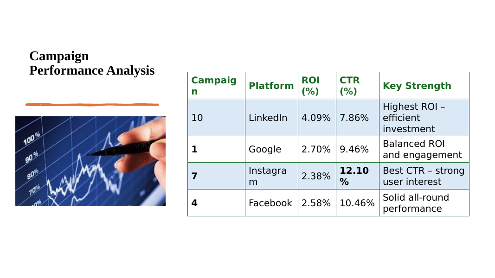
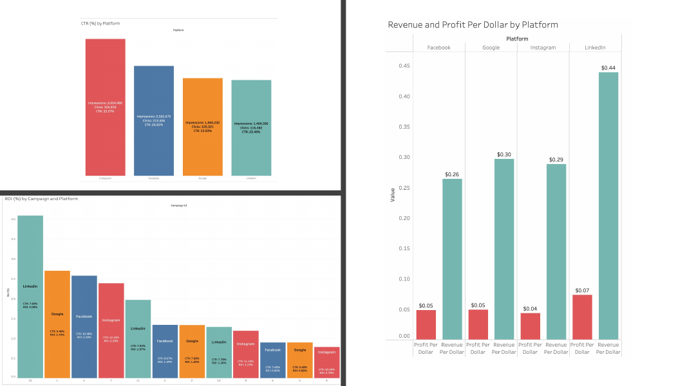

# Cyberdyne Campaign Performance Analysis (Tableau)

A team analysis of Cyberdyne's marketing campaigns across **Google, Facebook, Instagram and LinkedIn**, built in Tableau, with data-driven recommendations on where to invest next.

Team: Tisha Amali, Anjali Anantharaman, Rithu Rao Beedu, Praneth Nandeesh and Rohan Satishkumar.

## Business question

Which campaigns and platforms deliver the best return, and how should a limited budget ($2K, $5K or $30K) be allocated?

## What was analyzed

- Campaign performance metrics: **ROI, CTR, profit, cost per click, profit per dollar, revenue per dollar**
- Budget allocation scenarios, with an example $5,000 plan across campaigns 10, 7, 1 and 4 (estimated profit of about $158)
- Confounders and data limitations
- Platform-specific creative strategy, and regular posts vs. paid ads

## Key takeaways

- **LinkedIn** delivered the highest ROI (campaign 10: 4.09% ROI) and the best return per dollar, making it the strongest choice for larger budgets.
- **Instagram** had the strongest engagement and the lowest cost per click (campaign 7: 12.10% CTR), but conversion lagged, so creative should be tuned for conversion.
- **Facebook and Google** performed moderately and suit testing and targeting.
- Caveats: the same creative ran on every platform, campaigns promoted different products, spend varied widely, and no attribution model was provided, so ROI differences may partly reflect product mix rather than ad quality.





## Repository contents

```
cyberdyne-campaign-performance-tableau/
├── tableau/
│   └── cyberdyne_campaign_performance.twb   # Tableau workbook (8 worksheets)
└── docs/
    ├── Cyberdyne_Campaign_Performance_Presentation.pdf
    └── slides/                              # slide-by-slide previews (PNG)
```

The workbook includes worksheets for clicks vs. total profit, cost per click by platform, profit by platform, profit per dollar and revenue per dollar by platform. Fields used include Campaign Id, Platform, Product Category, Product Price, Impressions, Clicks, Cost, Revenue, Profit and Profit Margin.

## Opening the workbook

The workbook connects to a merged campaign dataset, `cyberdine_merged_data.csv`, which is **not included** here. Open the `.twb` in Tableau Desktop (or Tableau Public) and, when prompted, point the data source at your copy of that file.

## Author

Rohan Satishkumar, MS Marketing Analytics, Illinois Institute of Technology
